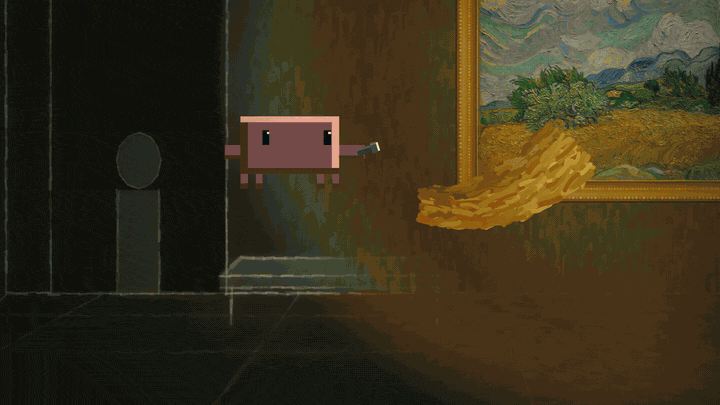

<div align="center">


# huashu-art-motion · Art Motion

Let your coding agent turn art styles into paintings that move.

35 art styles · 9 explainer grammars · 8 parameterized clips · reference code for full narrated films

```sh
npx skills add alchaincyf/huashu-art-motion
```

[Animations](#animation-samples) · [Styles](#see-it) · [Get started](#whats-inside) · [Download full samples](https://github.com/alchaincyf/huashu-art-motion/releases/latest)

[中文](README.md) · **English**

</div>

> English documentation covers the whole skill. For English requests, `SKILL.md` routes agents to [SKILL.en.md](SKILL.en.md) and the English references under `references/en/`. Chinese documents remain available through the language links.

## Animation samples

### Featured: Huashu jumps into Super Mario

Turn yourself into a pixel hero and run a full level. Bricks, pipes, level motion and transitions are done in code; the character is composited from generated frames. The clips below are cut straight from the 65-second film.


Even eating a mushroom requires picking a membership first: OpenAI or Claude? Pick Claude, the star power-up drops, and Huashu grows.

<table><tr>
<td width="50%"><br/>Stomp and kick · pixel Sam and Dario cameo as enemies</td>
<td width="50%"><br/>Down the pipe · coin room and scanline whip-pan</td>
</tr></table>

These show the finished film; GIFs are silent and loop. [Clip timestamps and export settings](assets/showcase/mario-clips.en.md).

### Clawd: Night at the Museum

Clawd, Claude Code's pixel mascot, hops out of the terminal on a security guard's computer, patrols the Metropolitan Museum of Art with a flashlight, crosses Central Park to the Natural History Museum, and races back before dawn to pose as an exhibit. 98 seconds, 16 scenes, no narration; the score is synthesized in code too.



Into Van Gogh's *Wheat Field with Cypresses*: brushstroke direction comes from the original's structure tensor, and Clawd is repainted in impasto.

<table><tr>
<td width="50%"><br/>T. rex skeleton · chasing the flashlight</td>
<td width="50%"><br/>Dawn · posing as an exhibit, one blink</td>
</tr></table>

The dark is a charcoal night scene; only what the flashlight hits shows color. The five paintings featured (Van Gogh, Seurat, Vermeer, Rembrandt, Leutze) are CC0 originals from The Met Open Access, each repainted in code in its painter's technique. Full film in [Releases](https://github.com/alchaincyf/huashu-art-motion/releases/latest); [clip timestamps and notes](assets/showcase/clawd-clips.en.md).

### Huashu through famous paintings

The paintings really move. The three clips below come from the same time-travel short: scenes are drawn in code, the character is composited from generated frames.


Skipping a stone from the Japanese bridge.

<table><tr>
<td width="50%"><br/>Ancient Egypt · scarab</td>
<td width="50%"><br/>8-bit · coin block</td>
</tr></table>

## See it


One frame from each of the 35 samples: the same girl, the same orange-and-white cat, the same table, traveling from a 40,000 BC cave to 2026. Every segment moves: Van Gogh's stars swirl, mosaic colors flow across the stones, ink wash bleeds the frame into the next era.

Note: all 35 tiles share one composition. That is the mechanism of the art-history speedrun (the style changes, the scene doesn't), not the composition of these styles. For a new subject, compose for that subject; don't move this room over.

👉 [Download the all-styles sample (MP4)](https://github.com/alchaincyf/huashu-art-motion/releases/latest)

Long-scroll film: one person walks left to right, and the moment they cross a boundary, the world and their own art style change together (below are the 3 demo segments shipped in the repo: Egyptian mural → Monet's *Japanese Bridge* → 8-bit):


Each of the 8 explainer grammars has a runnable demo film (one frame per shot below). A 9th, "presenter-led finance explainer", ships as a grammar card plus a full-film code snapshot that needs your own character. Whiteboard suits drawing relationships along with narration; Vox suits graphics and information collage:

| | |
|---|---|
|  Kurzgesagt: flat, no outlines, journeys across scale |  Vox: clippings, red lines, highlighter |
|  Whiteboard: pen tip reveals line art |  3Blue1Brown: one object morphs into the next |
|  Storytime: reaction close-ups, comedic pauses |  Kinetic type: the key word slams in |
|  Keynote: bokeh background, frosted-glass cards, big numbers |  Finance chart: axes first, then data, annotate one thing |

---

## What it does

| You say | It does |
|---|---|
| "Recreate this animation" / "Break this clip down" | Runs the breakdown script to measure cuts, beat grid and per-segment motion heatmaps, then recreates it in code by mechanism |
| "Make an animation like Van Gogh / Monet / Bauhaus" | Designs one frame first, then makes it move; 35 style recipe cards as starting points |
| "Turn my voiceover into an art animation" | Shot list → pick style → world canvas plus camera → output one picture track |
| "Make a film of someone walking through famous paintings" | Long-scroll skeleton: one segment file per world, the hero keeps walking right, style changes at each boundary, camera only moves forward |
| "Make animated segments for an explainer video" | Picks a grammar for the narration, feed it a JSON spec, get a clip timed to the exact frame (landscape/portrait, optional transparent background) |
| "I need a person in the shot" | People come from an image model as frames; code handles compositing, frame swaps and texture |
| "Score it and hit the beats" | BPM grid, motif re-orchestration, ending sound sequences, all synthesized in code |

Before delivery there is a numeric check: `qa.py` measures stability, efficiency, motion, smoothness and text-framing cues, then an agent that took no part in production reviews only the finished film for problems. Finally `deliver.py` delivers in one command: the film must first pass the anti-slideshow gate (if the whole film has almost no in-shot fast motion it goes red and nothing ships); only then does it copy the film and write delivery notes, with facts in the notes written by the script.

---

## What's inside

| | Count |
|---|---|
| Art style recipe cards (parameters, motif motions, signature transitions, known weaknesses) | 35, `references/en/style-recipes/` |
| Matching scene code | 35, `scripts/engine/scenes/` |
| Explainer animation grammar cards | 9; 8 of them with demo films, parameterized clips and sample specs |
| Reference code for full narrated films | Mixed styles, whiteboard, Vox, presenter; some assets must be supplied yourself, see the [reference-film README](scripts/engine/reference_films/spacex/README.en.md) |
| Long-scroll demo (skeleton + 3 segments + character frame library) | 1, `scripts/engine/demos/long_scroll/` |
| Transitions | Signature art-style transitions and explainer transitions, including fades, hard cuts and paper transitions |
| Painting and animation libraries (brushes, renderers, post, rigs, camera, charts, typography…) | 17, `scripts/engine/lib/` |
| Method docs (breakdown, mechanism, frame-first, pure-code drawing, rhythm and score, characters, long scroll…) | 12 core docs, from [01: breakdown](references/en/01-breakdown.md) to [12: full narrated films](references/en/12-full-narrated-films-and-feedback-loop.md); plus an [optional voice guide](references/en/capabilities.md) |

```
huashu-art-motion/
├── SKILL.md                 # classify the task first, then read the matching docs from the table
├── references/              # 01–12 method docs, 35 style recipe cards, 9 grammar cards, proven practices
├── assets/                  # overview images (used by the README)
└── scripts/
    ├── engine/              # self-contained animation project you can copy whole: engine, transitions, libs, scenes, demos, clips
    ├── analyze/breakdown.py # turns a reference animation into a "map you can code from"
    ├── qa.py                # one-command QA
    ├── film_gate.py         # film gate: measures slideshow feel, checks for blank mid-film frames (reads mp4 only)
    ├── deliver.py           # one-command delivery: gate → copy film → write delivery notes
    ├── audio/               # templates for scoring in pure code
    └── font_subset.py ...   # font subsetting, green-screen keying
```

Requirements: [uv](https://docs.astral.sh/uv/), ffmpeg, Playwright Chromium (first run: `uv run --with playwright playwright install chromium`). Try it:

```sh
cd huashu-art-motion
uv run --with playwright python scripts/engine/render.py --solo 09_postimp --stills 0.3 --out stills   # one frame of the Van Gogh segment
uv run --with playwright python scripts/engine/render.py --spec scripts/engine/examples/t3_finance_chart.json --out finance_chart.mp4
```

---

## The story behind it

In early October 2026 I saw a 15-second animation on X by Tak ([@cherry_mx_reds](https://x.com/cherry_mx_reds/status/2106095190285144331)): a girl and a cat travel through 40,000 years of art history, each era lasting about a second, yet everything in the paintings moves.

I asked Claude to recreate it. The first version was "transitions between still paintings", and I rejected it: each era in the original might only last a second, but everything in the frame flows. So we switched to breaking it down first (measuring cuts, fitting a beat grid, seeing where each segment moves), then painting it layer by layer in code and making it move.

Along the way I told it: "We're not just recreating this; I need you to accumulate experience." So this skill records not only code but which approaches proved effective (`references/en/07-proven-practices.md`) and each style's pitfalls and weaknesses. I then sent 4 groups of agents that had only read the skill to build 20 styles it had never seen, and merged the wheels each of them reinvented into a shared library. Then came 8 YouTube explainer grammars, wired into my own voiceover video pipeline. Finally I used the same toolkit to make *Huashu Through Famous Paintings*: 23 styles, 2:08, walking from the cave all the way to 2026. Its skeleton and 3 of its segments are included here.

---

## Acknowledgements

- **Tak ([@cherry_mx_reds](https://x.com/cherry_mx_reds))**'s *Art History Speedrun* is where this skill started. The scene compositions of the 16 art eras and the "girl + cat time travel" premise follow the original's ideas; every frame is redrawn in code, and the scoring script contains an original example score (only the breakdown method is kept, not a transcription of the original music). The repo contains no frames, screenshots or audio files from the original film. See his X for the original.
- Channels and sources analyzed in the grammar cards (Kurzgesagt, Vox, 3Blue1Brown, RSA Animate, TheOdd1sOut, etc.) are linked under "primary references" on each card. The repo records only measured parameters, none of their imagery.
- All fonts are SIL OFL 1.1 open-source fonts; see the [font list and copyright](scripts/engine/lib/fonts/LICENSES.en.md).

---

## About the author

| | |
|:---|:---|
| 🌐 Website | [bookai.top](https://bookai.top) · [huasheng.ai](https://www.huasheng.ai) |
| 𝕏 Twitter | [@AlchainHust](https://x.com/AlchainHust) |
| 📺 Bilibili | [花叔v](https://space.bilibili.com/14097567) |
| ▶️ YouTube | [@Alchain](https://www.youtube.com/@Alchain) |
| 📕 Xiaohongshu | [花叔](https://www.xiaohongshu.com/user/profile/5abc6f17e8ac2b109179dfdf) |
| 💬 WeChat Official Account | search "花叔" in WeChat |

## Optional media capabilities

Basic code animation needs no voice or image accounts. Existing assets are used first; when generation is needed, it follows the user's choices and the current environment. Voice supports macOS system voices and your own Volcengine cloned voice; images support importing existing files and bridging to the current agent's/MCP tools.

- [Voice and private config](references/en/capabilities.md): configure on demand, skippable; the old koubo entry point stays compatible.
- [Image tool integration](references/en/images.md): generate a plan first, let the agent call the tool, then verify and file the assets.
- [Compatibility and verification scope](references/en/compatibility.md): install/reinstall passes on all three hosts; Codex online regression passes; Claude Code/Kimi online regression is blocked by test-account conditions and still pending.
- [Maintenance, extension and release](CONTRIBUTING.en.md): public defaults kept separate from private config, upgrades don't overwrite personal choices, release checks cover the actual outgoing Git objects.

Run `python scripts/capabilities.py status --explain` first. New capabilities default to unselected and unauthorized; detecting a key or tool never implies permission to spend. A standalone image API executor is a possible future extension and will not switch providers automatically.

## Thanks for the feedback

Thanks to [@ismilewolf-eng](https://github.com/ismilewolf-eng) ([PR#1](https://github.com/alchaincyf/huashu-art-motion/pull/1)) and [@noahark](https://github.com/noahark) ([PR#2](https://github.com/alchaincyf/huashu-art-motion/pull/2)) for fix suggestions and verification of the Windows concurrent-loading failure, [@nctt777-hue](https://github.com/nctt777-hue) ([Issue#3](https://github.com/alchaincyf/huashu-art-motion/issues/3)) for detailed repro, controlled experiments and retesting, and [@GFXfly](https://github.com/GFXfly) for macOS troubleshooting feedback. This feedback helped fix the concurrent-loading problem in the render and QA local servers.

## License

Code and docs: MIT. Use it, change it, build with it.

Exceptions: the derived stroke-order data `reference_films/spacex/spacex_wb/assets/strokes.js` keeps the Arphic Public License (original text ships with the file); fonts in `scripts/engine/lib/fonts/` keep their respective OFL licenses; Huashu's cartoon likeness and character frames (`scripts/engine/demos/_shared/hero/`, `scripts/engine/demos/long_scroll/frames/`, `assets/角色/`), including the same likeness in overview images and demo videos, are for demonstrating this skill only and are not licensed under MIT for other uses.

Clawd is Anthropic's Claude Code mascot and its likeness belongs to Anthropic. *Clawd: Night at the Museum* is an unofficial fan demo, not affiliated with Anthropic; its GIFs and film are likewise not covered by MIT. The paintings in it come from The Met Open Access (CC0).

---

<div align="center">

**[Nuwa](https://github.com/alchaincyf/nuwa-skill)** builds Skills. **[Darwin](https://github.com/alchaincyf/darwin-skill)** evolves Skills. **Art Motion** makes paintings move.

MIT License © [花叔 Huashu](https://github.com/alchaincyf)

</div>

---

<div align="center">
<sub>Other projects by 花叔 Huashu</sub>

[](https://github.com/alchaincyf/fanbox)

</div>
