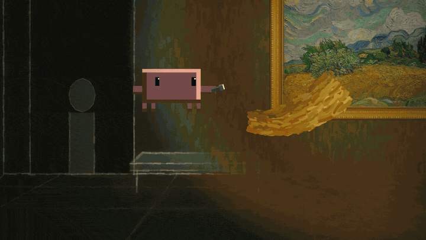
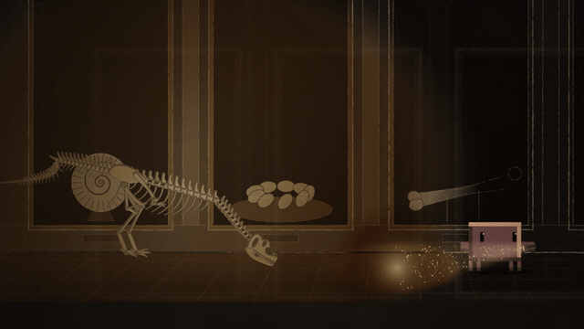
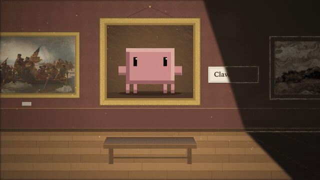

<div align="center">

[简体中文](README.md) | [English](README.en.md) | **Bahasa Indonesia**


# huashu-art-motion · Animasi Seni

Biarkan coding agent Anda menulis gaya seni menjadi lukisan yang bergerak.

36 gaya seni · 9 tata bahasa video penjelasan · 8 klip berparameter · kode referensi film narasi utuh

```sh
npx skills add alchaincyf/huashu-art-motion
```

[Lihat animasi](#cuplikan-animasi) · [Lihat gaya](#hasilnya) · [Mulai memakai](#isi-repo) · [Unduh cuplikan lengkap](https://github.com/alchaincyf/huashu-art-motion/releases/latest)

</div>

## Kabar terbaru

- 2026-10: [motion-design skill](https://github.com/nexu-io/open-design/blob/main/skills/motion-design/SOURCES.md) milik [Open Design](https://github.com/nexu-io/open-design) (ruang kerja desain AI sumber terbuka buatan nexu-io) mencantumkan huashu-art-motion sebagai salah satu sumber desain, dan memuat salinan adaptasi di [skills/huashu-art-motion](https://github.com/nexu-io/open-design/tree/main/skills/huashu-art-motion) dengan lisensi MIT dan tautan ke sumber aslinya tetap dipertahankan. Senang melihat cara membuat animasi seni ini dipakai proyek sumber terbuka lain; terima kasih kepada tim Open Design. Proyek lain yang ingin memakai, memberi masukan, atau berkontribusi sangat kami sambut.

## Cuplikan animasi

### Kasus utama: Huashu menerobos masuk ke Super Mario

Mengubah diri sendiri menjadi tokoh piksel dan menamatkan satu level penuh. Balok bata, pipa, gerak level, dan transisi dibuat dengan kode; tokohnya dikomposit dari frame hasil generasi gambar. Cuplikan di bawah diambil langsung dari film jadi berdurasi 65 detik.


Bahkan untuk makan jamur pun harus pilih langganan dulu: OpenAI atau Claude? Setelah memilih Claude, item bintang jatuh dan Huashu membesar.

<table><tr>
<td width="50%"><br/>Injak lalu tendang beruntun · Sam dan Dario versi piksel tampil sebagai musuh</td>
<td width="50%"><br/>Masuk pipa · ruang koin dan whip pan garis pindai</td>
</tr></table>

Bagian ini memperlihatkan hasil akhir; GIF tanpa suara dan berulang terus. [Titik waktu klip dan parameter ekspor](assets/showcase/mario-clips.md).

### Malam Ajaib Clawd di Museum

Clawd, maskot piksel Claude Code, melompat keluar dari terminal di komputer satpam, berpatroli malam dengan senter di Metropolitan Museum of Art New York, lalu menyeberangi Central Park ke Museum Sejarah Alam, dan kembali sebelum fajar untuk menyamar sebagai pajangan. 98 detik, 16 adegan, tanpa narasi, musiknya pun disintesis dengan kode.



Melompat ke dalam *Wheat Field with Cypresses* karya Van Gogh: arah sapuan kuas diambil dari structure tensor karya aslinya, dan Clawd digambar ulang dengan gaya impasto.

<table><tr>
<td width="50%"><br/>Kerangka T-Rex · mengejar bercak cahaya senter</td>
<td width="50%"><br/>Fajar · menyamar jadi pajangan dan berkedip sekali</td>
</tr></table>

Bagian gelap berupa pemandangan malam gaya arang, warna hanya muncul di tempat yang tersorot senter. Lima lukisan yang dimasuki (Van Gogh, Seurat, Vermeer, Rembrandt, Lenz) semuanya karya asli open access CC0 dari The Met, digambar ulang dengan kode mengikuti teknik tiap pelukisnya. Film lengkap ada di [Releases](https://github.com/alchaincyf/huashu-art-motion/releases/latest); [titik waktu klip dan keterangan](assets/showcase/clawd-clips.md).

### Huashu menembus lukisan-lukisan terkenal

Di dalam lukisan, semuanya benar-benar bergerak. Tiga bagian berikut berasal dari satu film pendek tembus-lukisan yang sama; adegan digambar dengan kode, tokoh dikomposit dari frame hasil generasi.


Satu lemparan batu pipih di Jembatan Jepang.

<table><tr>
<td width="50%"><br/>Mesir Kuno · kumbang scarab</td>
<td width="50%"><br/>8-bit · menyundul keluar koin</td>
</tr></table>

## Hasilnya


Satu frame dari masing-masing 35 cuplikan: gadis yang sama, kucing oranye-putih yang sama, meja yang sama, dari gua tahun 40000 SM hingga 2026. Setiap segmen bergerak: langit berbintang Van Gogh berputar, warna mosaik mengalir di atas batu-batunya, dan sapuan tinta membawa gambar ke zaman berikutnya.

Perhatian: 35 kotak ini memakai komposisi yang sama. Itu mekanisme film kilat sejarah seni (gaya berganti, adegan tetap), bukan komposisi khas gaya-gaya tersebut. Untuk topik baru, susun ulang komposisi sesuai topiknya; jangan memindahkan ruangan ini begitu saja.

👉 [Unduh cuplikan semua gaya (MP4)](https://github.com/alchaincyf/huashu-art-motion/releases/latest)

Film gulungan panjang: seorang tokoh berjalan dari kiri ke kanan, dan begitu melewati batas, dunia dan gaya lukisnya ikut berganti (gambar di bawah adalah 3 segmen contoh yang disertakan di repo: lukisan dinding Mesir → *Japanese Footbridge* Monet → piksel 8-bit):


Masing-masing dari 8 tata bahasa video penjelasan punya satu film contoh yang bisa dijalankan (gambar di bawah mengambil satu frame per shot). Ada juga tata bahasa ke-9, "sains keuangan populer ala presenter", yang menyediakan kartu tata bahasa dan snapshot kode film utuh yang memerlukan karakter milik sendiri. Papan tulis cocok untuk menggambar hubungan mengikuti narasi; Vox cocok untuk kolase grafik dan informasi:

| | |
|---|---|
|  Kurzgesagt: datar tanpa kontur, perjalanan lintas skala |  Vox: kliping koran, garis merah, stabilo |
|  Papan tulis: ujung pena menyingkap sketsa garis |  3Blue1Brown: satu objek berubah bentuk menjadi objek berikutnya |
|  Storytime: close-up reaksi, jeda untuk punchline |  Teks kinetik: kata utama menghantam masuk |
|  Peluncuran produk: latar bercak cahaya, kartu kaca buram, angka besar |  Grafik keuangan: sumbu dulu, data kemudian, hanya satu hal yang diberi label |

---

## Bisa membuat apa

| Anda bilang | Yang dikerjakan |
|---|---|
| "Tiru animasi ini", "bedah klip ini" | Menjalankan skrip bedah untuk mengukur transisi, grid ketukan, dan peta panas gerak tiap segmen, lalu menirunya dengan kode sesuai mekanismenya |
| "Buat animasi ala Van Gogh / Monet / Bauhaus" | Merancang satu frame dulu, baru menggerakkannya; 36 kartu resep gaya sebagai titik awal |
| "Buat animasi seni dari narasi suara saya" | Daftar shot → tentukan gaya → kanvas dunia plus kamera → keluarkan satu jalur gambar |
| "Buat film tentang seseorang yang melewati lukisan demi lukisan" | Kerangka gulungan panjang: satu file segmen per dunia, tokoh utama berjalan terus ke kanan, gaya lukis berganti di batas, kamera hanya maju tak mundur |
| "Buat segmen animasi untuk video penjelasan" | Pilih tata bahasa sesuai narasi, beri satu JSON, keluar satu klip dengan durasi tepat per frame (lanskap/potret, bisa latar transparan) |
| "Di gambar harus ada orang" | Orang dibuat oleh model generasi gambar sebagai frame; kode yang mengurus komposit, pergantian frame, dan material |
| "Tambahkan musik, ikuti ritme" | Grid BPM, pergantian instrumen per motif, rangkaian efek suara penutup, semuanya disintesis murni dengan kode |

Sebelum diserahkan ada satu pemeriksaan numerik: `qa.py` mengukur stabilitas, efisiensi, dinamika, kelancaran, serta petunjuk framing teks; lalu satu agent yang tidak ikut membuat hanya menonton film jadinya untuk mencari masalah. Terakhir `deliver.py` menyerahkan hasil dengan satu perintah: film jadi lebih dulu melewati gerbang anti-PPT (jika hampir tidak ada gerak cepat di dalam shot, lampu merah dan film tidak dikeluarkan), baru setelah lolos film disalin dan catatan penyerahan ditulis; fakta dalam catatan itu ditulis oleh skrip.

---

## Isi repo

| | Jumlah |
|---|---|
| Kartu resep gaya seni (parameter, aksi motif, transisi khas, kekurangan saat ini) | 53 kartu, di `references/风格配方/`; nomor 38–55 adalah resep riset yang dibuat ulang berdasarkan karya asli (termasuk lukisan dinding Dunhuang) |
| Kode adegan yang bersesuaian | 53, di `scripts/engine/scenes/` |
| Kartu tata bahasa animasi penjelasan | 9; 8 di antaranya dilengkapi film contoh, klip berparameter, dan contoh spec |
| Kode referensi film narasi utuh | Gaya campuran, papan tulis, Vox, presenter; sebagian bahan harus disiapkan sendiri, lihat README di direktorinya |
| Contoh film gulungan panjang (kerangka + 3 segmen + pustaka frame karakter) | 1, di `scripts/engine/demos/long_scroll/` |
| Audit tata letak dan uji beban (keluar bingkai / teks bertumpuk / teks terlalu kecil, varian potret / sangat panjang / bahasa Inggris, regresi contoh) | `render.py --audit`, `scripts/clip_lint.py`, `scripts/analyze/stress_clip.py`, `regress_clips.py` |
| Transisi | Transisi khas gaya seni dan transisi penjelasan, termasuk fade, hard cut, dan transisi kertas |
| Pustaka gambar dan animasi (kuas, renderer, post-effect, rangka, kamera, grafik, tipografi...) | 17, di `scripts/engine/lib/` |
| Dokumen metode (bedah, mekanisme, satu frame dulu, gambar murni kode, ritme dan musik, karakter, gulungan panjang...) | 12 dokumen inti, `references/01`–`12`; ditambah [panduan suara opsional](references/capabilities.md) |

```
huashu-art-motion/
├── SKILL.md                 # tentukan tugas dulu, lalu baca dokumen yang sesuai menurut tabel
├── references/              # dokumen metode 01–16, 53 kartu resep gaya, 9 kartu tata bahasa, pengalaman positif
├── assets/                  # gambar ikhtisar (untuk README)
└── scripts/
    ├── engine/              # proyek animasi yang bisa disalin utuh: mesin, transisi, pustaka, adegan, film contoh, klip
    ├── analyze/breakdown.py # membedah animasi referensi menjadi "peta yang bisa dikodekan"
    ├── qa.py                # pemeriksaan sekali jalan
    ├── film_gate.py         # gerbang film jadi: mengukur kesan PPT ganti-halaman, memeriksa frame kosong di tengah (hanya membaca mp4)
    ├── deliver.py           # penyerahan satu perintah: gerbang → salin film → tulis catatan penyerahan
    ├── audio/               # templat musik yang disintesis murni dengan kode
    └── font_subset.py ...   # subset font, chroma key layar hijau
```

Dependensi: [uv](https://docs.astral.sh/uv/), ffmpeg, Playwright Chromium (saat pertama kali jalankan `uv run --with playwright playwright install chromium`). Coba:

```sh
cd huashu-art-motion
uv run --with playwright python scripts/engine/render.py --solo 09_postimp --stills 0.3 --out 试渲   # satu frame segmen Van Gogh
uv run --with playwright python scripts/engine/render.py --spec scripts/engine/examples/t3_finance_chart.json --out 财经图表.mp4
```

---

## Kisah di baliknya

Awal Oktober 2026, di X saya melihat animasi 15 detik karya Tak ([@cherry_mx_reds](https://x.com/cherry_mx_reds/status/2106095190285144331)): seorang gadis dan seekor kucing menembus 40000 tahun sejarah seni, tiap zaman hanya sekitar satu detik, tetapi semua isi lukisannya bergerak.

Saya meminta Claude menirunya. Versi pertama berupa "transisi dari satu lukisan ke lukisan lain", dan saya tolak: tiap zaman di film aslinya mungkin hanya satu detik, tetapi unsur-unsur di dalam lukisannya mengalir sepenuhnya. Maka pendekatannya diubah: bedah dulu (ukur transisi, cocokkan grid ketukan, lihat bagian mana yang bergerak di tiap segmen), lalu dengan kode gambar lukisannya lapis demi lapis dan buat bergerak.

Selama mengerjakannya saya berkata kepadanya: "Kita bukan hanya meniru; saya ingin kamu mengumpulkan pengalaman." Karena itu skill ini mencatat bukan hanya kode, tetapi juga cara kerja mana yang terbukti efektif (`references/07-正面经验.md`), serta jebakan dan kekurangan tiap gaya. Setelah itu saya mengirim 4 kelompok agent yang hanya membaca skill untuk mengerjakan 20 gaya yang belum pernah dilihatnya, lalu menyatukan "roda" yang mereka buat masing-masing ke dalam satu pustaka seragam; ditambah 8 tata bahasa animasi penjelasan YouTube, yang disambungkan ke pipeline video narasi saya sendiri. Terakhir, dengan perangkat yang sama saya membuat *Huashu Menembus Lukisan Terkenal*: 23 gaya lukis, 2 menit 8 detik, dari gua hingga 2026; kerangkanya dan 3 segmen di antaranya juga disertakan.

---

## Ucapan terima kasih

- ***Art History Speedrun*** karya **Tak ([@cherry_mx_reds](https://x.com/cherry_mx_reds))** adalah titik awal skill ini. Komposisi adegan 16 zaman seni dan premis "gadis + kucing menembus waktu" mengikuti gagasan film aslinya; seluruh gambar digambar ulang dengan kode, dan skrip musiknya berisi partitur contoh orisinal (hanya metode bedahnya yang dipertahankan, tanpa transkripsi lagu aslinya); repo ini tidak memuat frame, tangkapan layar, maupun berkas audio film aslinya. Untuk melihat karya aslinya, kunjungi X milik Tak.
- Kanal dan sumber yang dibedah dalam kartu tata bahasa penjelasan (Kurzgesagt, Vox, 3Blue1Brown, RSA Animate, TheOdd1sOut, dll.) tautannya ada di bagian "rujukan primer" pada tiap kartu; repo hanya mencatat parameter hasil pengukuran, tanpa gambar milik mereka.
- Semua font adalah font sumber terbuka SIL OFL 1.1; daftar dan hak ciptanya ada di `scripts/engine/lib/fonts/LICENSES.md`.

---

## Tentang penulis

| | |
|:---|:---|
| 🌐 Situs | [bookai.top](https://bookai.top) · [huasheng.ai](https://www.huasheng.ai) |
| 𝕏 Twitter | [@AlchainHust](https://x.com/AlchainHust) |
| 📺 Bilibili | [花叔v](https://space.bilibili.com/14097567) |
| ▶️ YouTube | [@Alchain](https://www.youtube.com/@Alchain) |
| 📕 Xiaohongshu | [花叔](https://www.xiaohongshu.com/user/profile/5abc6f17e8ac2b109179dfdf) |
| 💬 Akun resmi WeChat | Cari "花叔" di WeChat |

## Lisensi

Kode dan dokumen: MIT. Silakan pakai, ubah, dan buat sesuka Anda.

Pengecualian: data turunan urutan goresan `reference_films/spacex/spacex_wb/assets/strokes.js` tetap berlisensi Arphic Public License (naskah aslinya disertakan bersama berkas); font di `scripts/engine/lib/fonts/` tetap mengikuti lisensi OFL masing-masing; citra kartun dan frame karakter Huashu (`scripts/engine/demos/_shared/hero/`, `scripts/engine/demos/long_scroll/frames/`, `assets/角色/`) serta citra yang sama yang terdapat dalam gambar ikhtisar dan video contoh hanya untuk demonstrasi skill ini, dan tidak dilisensikan di bawah MIT untuk keperluan lain.

Clawd adalah maskot Claude Code milik Anthropic, hak atas citranya ada pada Anthropic; *Malam Ajaib Clawd di Museum* adalah demonstrasi fan tidak resmi yang tidak terkait dengan Anthropic, dan GIF serta filmnya juga tidak dilisensikan di bawah MIT. Lukisan di dalam film berasal dari open access (CC0) The Metropolitan Museum of Art.

---

<div align="center">

**[Nuwa](https://github.com/alchaincyf/nuwa-skill)** menciptakan Skill. **[Darwin](https://github.com/alchaincyf/darwin-skill)** membuat Skill berevolusi. **Animasi Seni** membuat lukisan bergerak.

MIT License © [花叔 Huashu](https://github.com/alchaincyf)

</div>

---

<div align="center">
<sub>Proyek lain dari penulis · also by 花叔</sub>

[](https://github.com/alchaincyf/fanbox)

</div>

---

## Ringkasan bahasa Inggris

Bagian ini sudah berbahasa Inggris di [README.en.md](README.en.md) dan tidak diterjemahkan ulang.

## Kemampuan media opsional

Animasi kode dasar tidak memerlukan akun suara maupun gambar. Jika sudah punya bahan, pakai itu dulu; jika perlu generasi, panggil sesuai pilihan pengguna dan lingkungan saat ini. Suara mendukung suara sistem macOS dan suara klon Volcano milik sendiri; gambar mendukung impor berkas yang sudah ada dan jembatan ke alat Agent/MCP yang tersedia.

- [Suara dan konfigurasi pribadi](references/capabilities.md): dikonfigurasi sesuai kebutuhan, bisa dilewati, pintu masuk koubo lama tetap kompatibel.
- [Integrasi alat gambar](references/images.md): buat rencana dulu, Agent memanggil alat, lalu verifikasi dan simpan bahannya.
- [Kompatibilitas dan cakupan verifikasi](references/compatibility.md): instal dan instal ulang lulus di ketiga platform; regresi daring Codex lulus, regresi daring Claude Code/Kimi terhambat kondisi akun uji, menunggu verifikasi lanjutan.
- [Pemeliharaan, perluasan, dan rilis](CONTRIBUTING.md): default publik dipisahkan dari konfigurasi pribadi, pembaruan tidak menimpa pilihan pribadi, pemeriksaan rilis mencakup objek Git yang benar-benar akan dirilis.

Jalankan dulu `python scripts/capabilities.py status --explain`. Kemampuan baru secara default belum dipilih dan belum diizinkan; keberadaan Key atau alat yang terdeteksi tidak boleh dianggap sebagai izin untuk menggunakan biaya. Eksekutor API gambar mandiri adalah perluasan opsional di masa depan dan tidak akan otomatis berganti penyedia.

## Terima kasih atas masukannya

Terima kasih kepada [@ismilewolf-eng](https://github.com/ismilewolf-eng) ([PR#1](https://github.com/alchaincyf/huashu-art-motion/pull/1)) dan [@noahark](https://github.com/noahark) ([PR#2](https://github.com/alchaincyf/huashu-art-motion/pull/2)) atas usulan perbaikan dan verifikasi untuk gangguan pemuatan konkuren di Windows, [@nctt777-hue](https://github.com/nctt777-hue) ([Issue#3](https://github.com/alchaincyf/huashu-art-motion/issues/3)) atas reproduksi rinci, eksperimen pembanding, dan uji ulang, serta [@GFXfly](https://github.com/GFXfly) atas tambahan masukan pemecahan masalah di macOS. Masukan ini membantu kami memperbaiki masalah pemuatan konkuren pada server lokal untuk render dan QA.

## Gaya ke-36: Rick & Morty

Ditambahkan [resep gaya](references/风格配方/37_rick_morty.md) dan [contoh yang bisa disalin](scripts/engine/reference_films/rick_morty/index.html): pratinjau luring, garis waktu bisa digeser, tatapan/kedipan/mengangkat gelas/lompatan kucing bisa dikendalikan, serta ekspor video per frame. ID internalnya 37_rick_morty (36_picasso_blue sudah terpakai). Ini adalah pipeline SVG mandiri; ikhtisar sejarah 35 kotak di atas dan galeri Canvas tidak mencakup contoh ini. Setelah diunduh, buka HTML contoh untuk pratinjau; perintah ekspor ada di resep.
