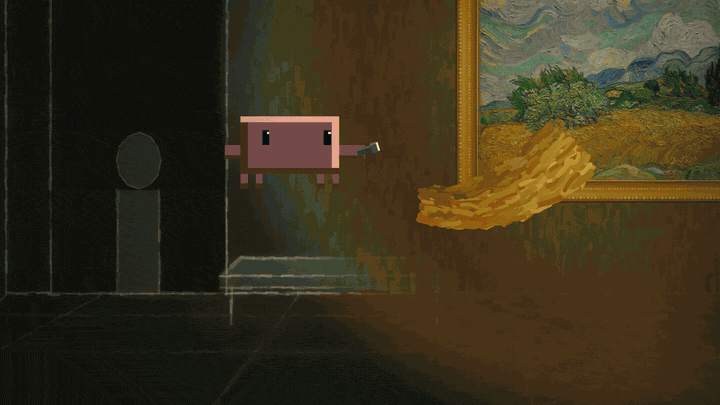
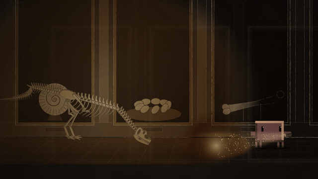
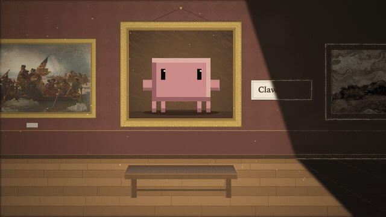

<div align="center">

[简体中文](README.md) | [English](README.en.md) | [Bahasa Indonesia](README.id.md) | **日本語**


# huashu-art-motion · Art in Motion

あなたの coding agent に、アートスタイルを動く絵に変えてもらいましょう。

36種類のアートスタイル · 9種類の解説アニメーション文法 · 8種類のパラメーター化クリップ · ナレーション付き映像のリファレンスコード

```sh
npx skills add alchaincyf/huashu-art-motion
```

[アニメーションを見る](#アニメーション作品例) · [スタイルを見る](#効果を見る) · [はじめる](#含まれるもの) · [完全版デモをダウンロード](https://github.com/alchaincyf/huashu-art-motion/releases/latest)

</div>

スキルの指示書とほとんどのリファレンスドキュメントは中国語で書かれています。この README は日本語のガイドであり、インストールされるスキル自体を翻訳するものではありません。

## ニュース

- 2026-10: nexu-io によるオープンソースの AI デザインワークスペース [Open Design](https://github.com/nexu-io/open-design) が、[motion-design スキル](https://github.com/nexu-io/open-design/blob/main/skills/motion-design/SOURCES.md)のデザインソースとして huashu-art-motion を掲載し、MIT ライセンスと上流へのリンクを残したうえで、改変版を [skills/huashu-art-motion](https://github.com/nexu-io/open-design/tree/main/skills/huashu-art-motion) に収録しました。このアートアニメーションの手法が別のオープンソースプロジェクトで使われていることをうれしく思い、Open Design チームに感謝します。ほかのプロジェクトでの活用、フィードバック、コントリビューションも歓迎します。

## アニメーション作品例

### 注目のデモ：花叔、スーパーマリオの世界へ

自分をピクセルアートのヒーローにして、ステージを丸ごとプレイします。ブロック、土管、ステージの移動、トランジションはコードで作られ、キャラクターは生成したフレームから合成されています。これらのクリップは65秒の映像からそのまま切り出したものです。


キノコを食べるにもサブスクリプションを選ばなければなりません。OpenAI か、Claude か？ Claude を選ぶと、スターバーストのパワーアップが落ちてきて花叔が大きくなります。

<table><tr>
<td width="50%"><br/>踏みつけとキック · ピクセルの Sam と Dario が敵役でカメオ出演</td>
<td width="50%"><br/>土管の中へ · コイン部屋と走査線のウィップトランジション</td>
</tr></table>

これらは完成した映像です。GIF は無音でループします。[クリップのタイムスタンプと書き出し設定](assets/showcase/mario-clips.md)を参照してください。

### Clawd：ナイト・ミュージアム

Claude Code のピクセルマスコット Clawd が、警備員のパソコンのターミナルから飛び出し、懐中電灯を手にニューヨークのメトロポリタン美術館を探検し、セントラルパークを横切って自然史博物館へ向かい、夜明け前に戻って展示品のふりをします。映像は16シーン・98秒で、ナレーションはありません。音楽もコードで合成されています。



ゴッホの『糸杉のある麦畑』の中では、筆致の方向は原画の構造テンソルから取られ、Clawd は厚塗り（インパスト）で描き直されています。

<table><tr>
<td width="50%"><br/>ティラノサウルスの骨格 · 懐中電灯の光を追いかける</td>
<td width="50%"><br/>夜明け · 展示品のふりをして、一度だけまばたき</td>
</tr></table>

暗闇は木炭画風の夜景としてレンダリングされ、懐中電灯が照らした部分にだけ色が現れます。Clawd が入り込む5枚の絵画（ゴッホ、スーラ、フェルメール、レンブラント、ロイツェ）は、メトロポリタン美術館の Open Access コレクションに含まれる CC0 の原画で、それぞれの画家の筆致を使ってコードで描き直されています。完全版の映像は [Releases](https://github.com/alchaincyf/huashu-art-motion/releases/latest) に、[クリップのタイムスタンプと解説](assets/showcase/clawd-clips.md)とあわせて掲載しています。

### 花叔、名画の中を歩く

絵画が本当に動きます。この3つのクリップは同じ旅の映像からのもので、シーンはコードで描かれ、キャラクターは生成したフレームから合成されています。


日本の橋のそばで水切り。

<table><tr>
<td width="50%"><br/>古代エジプト · スカラベ</td>
<td width="50%"><br/>8ビット · ブロックからコイン</td>
</tr></table>

## 効果を見る


35本のアニメーションデモから1フレームずつ並べています。同じ少女、オレンジと白の猫、テーブルが、紀元前40,000年の洞窟から2026年まで旅をします。どのシーンも動きます。ゴッホの星空は渦を巻き、モザイクの色は石の上を流れ、水墨のにじみが画面を次の時代へと運びます。

共通の構図は「アート史スピードラン」の一部であり、場面はそのままにスタイルだけが変わります。これらのスタイルに決められた構図ではありません。新しい題材では、この部屋を使い回すのではなく、新しい構図を設計してください。

👉 [全スタイルのデモをダウンロード（MP4）](https://github.com/alchaincyf/huashu-art-motion/releases/latest)

長巻（ロングスクロール）デモでは、キャラクターが左から右へ歩いていきます。境界を越えるたびに、世界とキャラクターの両方のアートスタイルが変わります。リポジトリには3つのサンプル世界が含まれています：エジプトの壁画 → モネの『日本の橋』 → 8ビット。


8種類の解説アニメーション文法には、それぞれ実行可能なデモ映像があります。下の画像はショットごとに1フレームを示しています。9番目の文法であるプレゼンター主導の金融解説には、文法カードと映像全体のコードスナップショットが含まれていますが、キャラクター素材は各自で用意する必要があります。Whiteboard はナレーションに合わせて関係図を描くのに向いており、Vox はグラフィックや情報のコラージュに向いています。

| | |
|---|---|
|  Kurzgesagt：輪郭線のないフラットな図形、スケールを横断する旅 |  Vox：切り抜き、赤い線、蛍光ペンのマーク |
|  Whiteboard：ペン先が線画を描き出していく |  3Blue1Brown：あるオブジェクトが次のオブジェクトへ変形する |
|  Storytime：リアクションのクローズアップと、ジョークのための間 |  キネティックタイポ：キーワードがインパクトとともに着地する |
|  Keynote UI：光のスポット、すりガラスのカード、大きな数字 |  金融チャート：まず軸、次にデータ、そして1点を強調 |

---

## できること

| あなたの依頼 | スキルが行うこと |
|---|---|
| 「このアニメーションを再現して」「このクリップを分解して」 | 分解スクリプトを実行して、セグメントごとにトランジション、ビートグリッド、モーションヒートマップを計測し、その背後にある仕組みをコードで再現します |
| 「ゴッホ、モネ、バウハウスのスタイルでアニメーションを作って」 | まず1フレームを設計し、それからアニメーション化します。36枚のスタイルレシピカードが出発点になります |
| 「私のナレーションからアートアニメーションを作って」 | ショットリストを作成 → スタイルを選択 → ワールドキャンバスにカメラを追加 → 映像トラックを出力します |
| 「名画の中を人が歩いていく映像を作って」 | 長巻スケルトンを使います。世界ごとに1つのセグメントファイル、右へ進むヒーロー、境界でのスタイル変化、前にだけ進むカメラで構成します |
| 「解説動画用のアニメーションパートを作って」 | ナレーションに合った文法を選び、JSON spec をフレーム単位で正確なクリップにレンダリングします。横向き・縦向きに対応し、透過も選べます |
| 「シーンに人物を入れたい」 | キャラクターのフレームには画像生成モデルを使い、合成、フレームの切り替え、質感はコードで処理します |
| 「音楽を付けて、動きにタイミングを合わせて」 | BPM グリッド、楽器間で受け渡されるモチーフ、締めくくりの効果音シーケンスを使い、コードで音楽を合成します |

納品前に、`qa.py` が安定性、効率、動き、滑らかさ、テキストボックスの枠取りの手がかりを計測します。次に、その映像を作っていない別の agent が完成品をレビューします。最後に `deliver.py` が1コマンドで納品を行います。映像はまずスライドショー化防止ゲートを通過する必要があり、映像のほぼ全体でショット内の速い動きが欠けていると、納品はブロックされます。通過すると、スクリプトが映像をコピーし、計測された事実に基づいて納品メモを書きます。

---

## 含まれるもの

| コンポーネント | 数量 / 場所 |
|---|---|
| アートスタイルのレシピカード：パラメーター、モチーフの動き、特徴的なトランジション、現時点での制限 | `references/风格配方/` に36枚 |
| 対応するシーンのコード | `scripts/engine/scenes/` に35シーン |
| 解説アニメーション文法カード | 9枚。うち8枚にデモ映像、パラメーター化クリップ、spec の例を収録 |
| ナレーション付き映像のリファレンスコード | ミックススタイル、Whiteboard、Vox、プレゼンター主導の解説。一部の素材は別途用意が必要です。各ディレクトリの README を参照してください |
| 長巻デモ：スケルトン、3つの世界、キャラクターフレームライブラリ | `scripts/engine/demos/long_scroll/` に1本 |
| トランジション | アートスタイル特有のトランジションと解説用トランジション（フェード、ハードカット、紙のトランジションなど） |
| 描画・アニメーションライブラリ：ブラシ、レンダラー、ポストプロセス、スケルトン、カメラ、チャート、タイポグラフィなど | `scripts/engine/lib/` に17ライブラリ |
| 手法ドキュメント：分解、仕組み、一フレーム先行の設計、コードによる描画、音楽とリズム、キャラクター、長巻映像など | コアドキュメント12本（`references/01`–`12`）と、[オプションの音声ガイド](references/capabilities.md) |

```text
huashu-art-motion/
├── SKILL.md                 # Classify the task, then read the relevant documents
├── references/              # Methods 01–12, 36 style recipes, 9 grammar cards, proven practices
├── assets/                  # Overview images used in the README
└── scripts/
    ├── engine/              # Portable animation project: engine, transitions, libraries, scenes, demos, clips
    ├── analyze/breakdown.py # Turn a reference animation into a map you can implement in code
    ├── qa.py                # Run QA in one command
    ├── film_gate.py         # Detect slideshow-like cuts and empty middle sections; reads MP4 only
    ├── deliver.py           # Gate → copy the film → write delivery notes
    ├── audio/               # Templates for music synthesized in code
    └── font_subset.py ...   # Font subsetting and green-screen removal
```

[uv](https://docs.astral.sh/uv/)、ffmpeg、Playwright Chromium が必要です。初回のレンダリング前に Chromium をインストールしてください：

```sh
uv run --with playwright playwright install chromium
```

ゴッホのシーンから1フレーム、または金融チャートのクリップをレンダリングしてみましょう：

```sh
cd huashu-art-motion
uv run --with playwright python scripts/engine/render.py --solo 09_postimp --stills 0.3 --out preview
uv run --with playwright python scripts/engine/render.py --spec scripts/engine/examples/t3_finance_chart.json --out finance-chart.mp4
```

---

## 誕生の経緯

2026年10月初旬、私は X で Tak さん（[@cherry_mx_reds](https://x.com/cherry_mx_reds/status/2106095190285144331)）の15秒のアニメーションを見ました。少女と猫が4万年のアート史を旅する作品です。各時代はわずか1秒ほどしかないのに、絵の中のものは動き続けていました。

私は Claude にそれを再現するよう頼みました。最初のバージョンは静止した絵画の間をトランジションでつないだだけでした。私はそれを却下しました。原作がある時代に1秒しか費やしていなくても、絵の中の要素は動いているからです。そこで分解から始めました。トランジションを計測し、ビートグリッドを当てはめ、各セグメントのどこが動いているかを確認し、そのうえで絵画を1レイヤーずつコードで描き、動かしていきました。

その過程で、私はこう伝えました。「ただ再現するだけじゃない。ここから学んでほしいんだ」。そのため、このスキルにはコードだけでなく、役に立つと実証されたプラクティス（`references/07-正面经验.md`）や、各スタイルの落とし穴と制限も記録されています。その後、スキルだけを渡された4つの agent グループが、スキルにとって初見の20スタイルを作りました。再利用可能なコンポーネントは共有ライブラリになりました。さらに YouTube の解説アニメーション文法を8種類追加し、私のナレーション動画パイプラインと接続しました。最後に、同じツールで『花叔、名画の中を歩く』を作りました。2分8秒で23のスタイルを巡り、洞窟から2026年まで歩いていく作品です。そのスケルトンと3つのサンプル世界がここに含まれています。

---

## 謝辞

- **Tak さん（[@cherry_mx_reds](https://x.com/cherry_mx_reds)）** と彼の『Art History Speedrun』がこのスキルのきっかけになりました。16のアート時代のシーン構図と、少女と猫の旅は原作のアイデアに沿っています。ここにある画像はすべてコードで描き直したものです。音楽スクリプトにはオリジナルのサンプル楽譜が含まれており、リポジトリに残しているのは分解の手法であって、原作の音楽の書き起こしではありません。原作映像のフレーム、スクリーンショット、音声ファイルは一切含まれていません。原作は彼の X アカウントでご覧ください。
- 解説文法カードで研究したチャンネルや資料（Kurzgesagt、Vox、3Blue1Brown、RSA Animate、TheOdd1sOut など）は、各カードの主要な参考資料にリンクしています。リポジトリに記録しているのは計測したパラメーターであり、彼らの映像ではありません。
- フォントは SIL OFL 1.1 のオープンソースです。一覧と著作権表示は `scripts/engine/lib/fonts/LICENSES.md` を参照してください。

---

## 作者について

| | |
|:---|:---|
| 🌐 Web サイト | [bookai.top](https://bookai.top) · [huasheng.ai](https://www.huasheng.ai) |
| 𝕏 Twitter | [@AlchainHust](https://x.com/AlchainHust) |
| 📺 Bilibili | [花叔v](https://space.bilibili.com/14097567) |
| ▶️ YouTube | [@Alchain](https://www.youtube.com/@Alchain) |
| 📕 小紅書（Xiaohongshu） | [花叔](https://www.xiaohongshu.com/user/profile/5abc6f17e8ac2b109179dfdf) |
| 💬 WeChat 公式アカウント | WeChat で「花叔」と検索してください |

## ライセンス

コードとドキュメント：MIT。自由に使用、改変、発展させてください。

例外：`scripts/engine/reference_films/spacex/spacex_wb/assets/strokes.js` に含まれる派生した筆順データは Arphic Public License を保持しており、その条文がファイルに同梱されています。`scripts/engine/lib/fonts/` のフォントはそれぞれの OFL ライセンスを保持しています。花叔のカートゥーン肖像とキャラクターフレーム（`scripts/engine/demos/_shared/hero/`、`scripts/engine/demos/long_scroll/frames/`、`assets/角色/`）は、一覧画像やデモ動画に含まれる同じ肖像も含め、このスキルのデモンストレーション用としてのみ提供されており、MIT のもとでほかの用途に使用することは許諾されていません。

Clawd は Anthropic の Claude Code マスコットであり、その肖像に関する権利は Anthropic に帰属します。『Clawd：ナイト・ミュージアム』は非公式のファンデモであり、Anthropic とは関係ありません。その GIF と完全版映像も MIT ライセンスの対象外です。映像内の絵画はメトロポリタン美術館の Open Access コレクション（CC0）のものです。

---

<div align="center">

**[Nuwa](https://github.com/alchaincyf/nuwa-skill)** はスキルを作り、**[Darwin](https://github.com/alchaincyf/darwin-skill)** はスキルを進化させ、**Art in Motion** は絵画を動かします。

MIT License © [花叔 Huashu](https://github.com/alchaincyf)

</div>

---

<div align="center">
<sub>花叔のその他のプロジェクト</sub>

[](https://github.com/alchaincyf/fanbox)

</div>

---

## オプションのメディア機能

基本的なコードアニメーションには、音声や画像生成のアカウントは必要ありません。まず既存の素材を再利用し、生成が必要な場合は、ユーザーが選んだプロバイダーと現在の環境で使えるツールを使います。音声の選択肢には、macOS のシステム音声や、Volcengine 上の自分の声のクローンがあります。画像の選択肢には、既存ファイルのインポートや、現在の agent の画像ツールまたは MCP ツールへのブリッジがあります。

- [音声とプライベート設定](references/capabilities.md)：必要なときだけ設定するか、スキップしてください。従来の `koubo` エントリーポイントも引き続き互換性があります。
- [画像ツールとの連携](references/images.md)：まず計画を作成し、agent にツールを呼び出させ、その後に素材を検証して収集します。
- [互換性と検証範囲](references/compatibility.md)：サポート対象の3つの agent（Claude Code、Codex、Kimi）すべてでインストールと再インストールを確認済みです。ライブ回帰テストは Codex で合格しています。Claude Code と Kimi のライブ回帰テストはテストアカウントの条件により保留中で、さらなる検証が必要です。
- [メンテナンス、拡張、リリース](CONTRIBUTING.md)：公開デフォルトはプライベート設定と分離され、アップグレード時には個人の選択が保持され、リリースチェックでは実際に公開される Git オブジェクトを検査します。

まずは `python scripts/capabilities.py status --explain` から始めてください。新しい機能はデフォルトで未選択・未許可です。キーやツールが見つかっても、費用を使ってよいという意味にはなりません。スタンドアロンの画像 API 実行器は、将来のオプション拡張として残っています。スキルが自動でプロバイダーを切り替えることはありません。

## フィードバックへの感謝

Windows での同時読み込みの失敗について修正案と検証を提供してくれた [@ismilewolf-eng](https://github.com/ismilewolf-eng) さん（[PR #1](https://github.com/alchaincyf/huashu-art-motion/pull/1)）と [@noahark](https://github.com/noahark) さん（[PR #2](https://github.com/alchaincyf/huashu-art-motion/pull/2)）、詳細な再現手順、対照実験、再テストを提供してくれた [@nctt777-hue](https://github.com/nctt777-hue) さん（[Issue #3](https://github.com/alchaincyf/huashu-art-motion/issues/3)）、そして macOS のトラブルシューティングについて追加のフィードバックをくれた [@GFXfly](https://github.com/GFXfly) さんに感謝します。皆さんの報告のおかげで、レンダリングと QA に使うローカルサーバーの同時読み込みを修正できました。

## スタイル36：Rick & Morty

[レシピ](references/风格配方/37_rick_morty.md)と[スタンドアロンの SVG サンプル](scripts/engine/reference_films/rick_morty/index.html)により、オフライン再生、決定的なシーク、視線・まばたき・すする・ジャンプの操作、フレーム単位の動画書き出しが追加されます。内部 ID：37_rick_morty（36_picasso_blue はすでに使用済み）。過去の35フレーム一覧と Canvas ギャラリーには、この SVG サンプルは含まれていません。フォルダーをダウンロードしてローカルで index.html を開いてください。レンダリングコマンドはレシピを参照してください。
